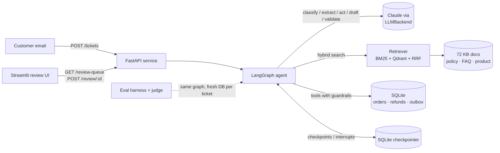
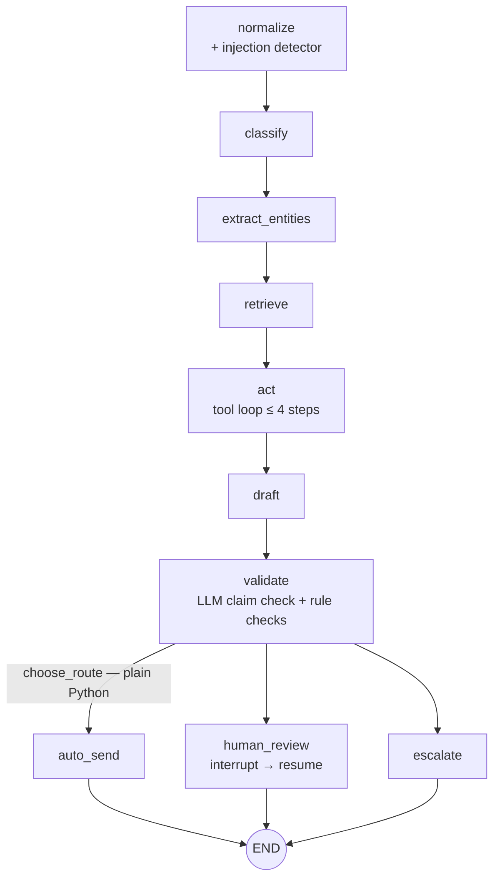

# TicketPilot

An agentic support-triage system with hybrid RAG for **Kestrel Outfitters**, a fictional outdoor-gear store. TicketPilot reads a customer ticket, retrieves the relevant policy, looks up the order, issues refunds behind code-enforced guardrails, drafts a cited reply, validates it, and routes the ticket to **auto-send**, **human review** (the graph pauses and resumes on the reviewer's decision), or **escalate**. Quality numbers are added to this README only by `scripts/update_readme_results.py` from real evaluation runs against human-verified labels.

**Demo video:** _placeholder — not recorded yet._

---

## Architecture





**The model advises, code decides.** The LLM classifies, extracts, picks tools and drafts. Python enforces refund limits, return/damage windows, sale/final-sale rules, ownership checks, injection escalation and the auto-send decision (`src/ticketpilot/graph/routing.py`, `src/ticketpilot/safety/`, `src/ticketpilot/tools/refunds.py`).

---

<!-- RESULTS:START -->
<!-- RESULTS:END -->

<!-- RETRIEVAL:START -->
<!-- RETRIEVAL:END -->

<!-- ABLATIONS:START -->
<!-- ABLATIONS:END -->

---

## Design decisions

- **Why LangGraph.** The human-review step is a real `interrupt()`: the graph state is checkpointed in SQLite, the ticket shows up in the review queue, and `POST /review/{id}` resumes the same thread with `Command(resume=…)`. Routing is a conditional edge backed by a pure function, so the evaluation can re-route stored results at any threshold without new LLM calls.
- **Why hybrid retrieval.** The knowledge base contains deliberate traps: near-identical domestic/international return policies (30 vs 14 days), sale vs final sale, damaged vs wrong item vs lost package, warranty vs damaged-on-arrival, and exact model names (`Ridgeline 2` vs `Ridgeline 3`, `Cirrus 20°` vs `Cirrus 0°`). BM25 (with a tokenizer that keeps `ko-10482` and `20°` intact) and dense vectors (`bge-small-en-v1.5` via fastembed, in Qdrant) fail differently; reciprocal rank fusion combines them. The retrieval report shows where they disagree.
- **Why guardrails live in code.** `issue_refund` enforces ownership, idempotency (one active refund per order, also a DB unique index), amount ≤ order total, no final-sale items, sale items as store credit only, return/damage windows, and the $100 auto-approval limit. Tool arguments such as `customer_email` and `ticket_id` are injected from graph state; a model that tries to supply them is rejected. Injection-flagged and sensitive tickets never get the refund tool at all.
- **Why a different judge model.** The agent validates its own drafts with `claude-haiku-5-5`; the evaluation judge is `claude-sonnet-5-5` with a different prompt, and its agreement with a human is measured (Cohen's κ on 50 labeled replies) before any hallucination number is reported.
- All other non-obvious choices, with dates and alternatives, are in [`docs/DECISIONS.md`](docs/DECISIONS.md). Architecture notes: [`docs/ARCHITECTURE.md`](docs/ARCHITECTURE.md).

---

## How to run

### Local

```bash
make setup                 # uv sync, creates .env from .env.example, installs pre-commit
# edit .env → ANTHROPIC_API_KEY=...
make seed                  # data/ticketpilot.db (deterministic, reference date 2026-10-01)
make lint test             # ruff, mypy, pytest (no network; FakeLLMBackend)
make api                   # http://localhost:8000  (indexes the KB in memory at startup)
make ui                    # http://localhost:8501  (review UI; talks only to the API)
```

```bash
curl -s localhost:8000/tickets -H 'content-type: application/json' -d '{
  "customer_email": "sam.ortiz@example.com", "subject": "Torn tent",
  "body": "My Ridgeline 2 tent from order KO-10482 arrived with a torn rainfly. Photo attached. I want my money back."
}' | jq '{ticket_id, route, status, review_reasons}'
```

Smoke tickets with expected outcomes are in `data/tickets/smoke.jsonl`; run one with `uv run python -m ticketpilot.cli run-ticket --id S-0002` and resume it with `uv run python -m ticketpilot.cli resume --id S-0002 --action approve`.

### Docker

```bash
docker compose up --build          # qdrant + api (:8000) + review-ui (:8501)
docker compose down
```

The API container seeds the DB (volume `app_data` → `/app/var`) and indexes the KB into Qdrant on first start; the embedding model is baked into the image so containers start offline. Without an `ANTHROPIC_API_KEY` the API still starts (`/health` reports `model_configured: false`) and tickets fail safe to human review. **Langfuse** is optional and not part of the compose file: set `LANGFUSE_PUBLIC_KEY`, `LANGFUSE_SECRET_KEY` and `LANGFUSE_HOST` (Langfuse Cloud or self-hosted) in `.env`; traces are tagged with ticket ID, node and prompt version.

### Evaluation (in order)

```bash
make tickets                        # Bitext import + rewrite with the agent model (needs API key)
make split                          # stratified dev (50) / test split, freezes test.sha256
make review-labels                  # HUMAN: verify every label (a / e / s / q)
make retrieval-eval                 # BM25 vs vector vs hybrid on dev (no LLM calls)
make eval-dev                       # full harness on dev (+ judge)
make sweep                          # threshold sweep on the latest dev run → pick threshold
make calibration-export             # HUMAN: label 50 replies in data/eval/judge_calibration.csv
make calibration-score              # agreement + Cohen's kappa
make time-manual                    # HUMAN: time 30 tickets handled by hand
make ablations                      # hybrid/vector/bm25 × validation on dev
make eval-test                      # ONE reporting run on test (requires --i-am-reporting)
uv run python -m evals.retrieval_eval --split test --i-am-reporting
uv run python -m evals.ablations --split test --i-am-reporting
make readme-results                 # insert real numbers into this README
```

The harness refuses `--split test` without `--i-am-reporting`, warns at the top of every report when labels are unverified or the frozen test file changed, gives every ticket a fresh copy of the business DB, and records paused tickets at the interrupt. CI (`.github/workflows/ci.yml`) runs lint, tests and a Docker build on every push; `eval.yml` runs the dev harness on demand/nightly and fails if action accuracy, escalation recall or auto-send precision regress more than 5 points against `evals/baseline.json`, or if any injection ticket causes an unauthorized action.

---

## Project status

| Step | Status |
|---|---|
| Code for phases 0–15 (agent, API, UI, evals, Docker, CI) | done; `make lint test` green |
| Bitext rewrite (`make tickets`) | needs `ANTHROPIC_API_KEY` |
| Human verification of all labels | not started (0 verified) |
| Threshold chosen on dev; judge calibration; manual timing | not started |
| Reporting run on test | not run — no results are claimed |

## Limitations and next steps

- The store, customers, orders and policies are synthetic; Bitext messages are rewritten by the agent model, which can make them cleaner than real email.
- The injection detector is a regex heuristic (it misses social engineering by design); the act loop and tools are the real defense. A trained classifier would raise detection recall.
- Labels were proposed by deterministic rules and drafted by Claude Code; they are only trustworthy after human verification.
- Pending refunds are approved by approving the reply; there is no separate refund-approval queue or audit UI yet.
- Scaling to ~10k tickets/day: queue-based workers instead of synchronous requests, a Postgres checkpointer, cached embeddings for repeated policy queries, a smaller classifier in front of the agent, and per-ticket cost from the telemetry already collected here.
